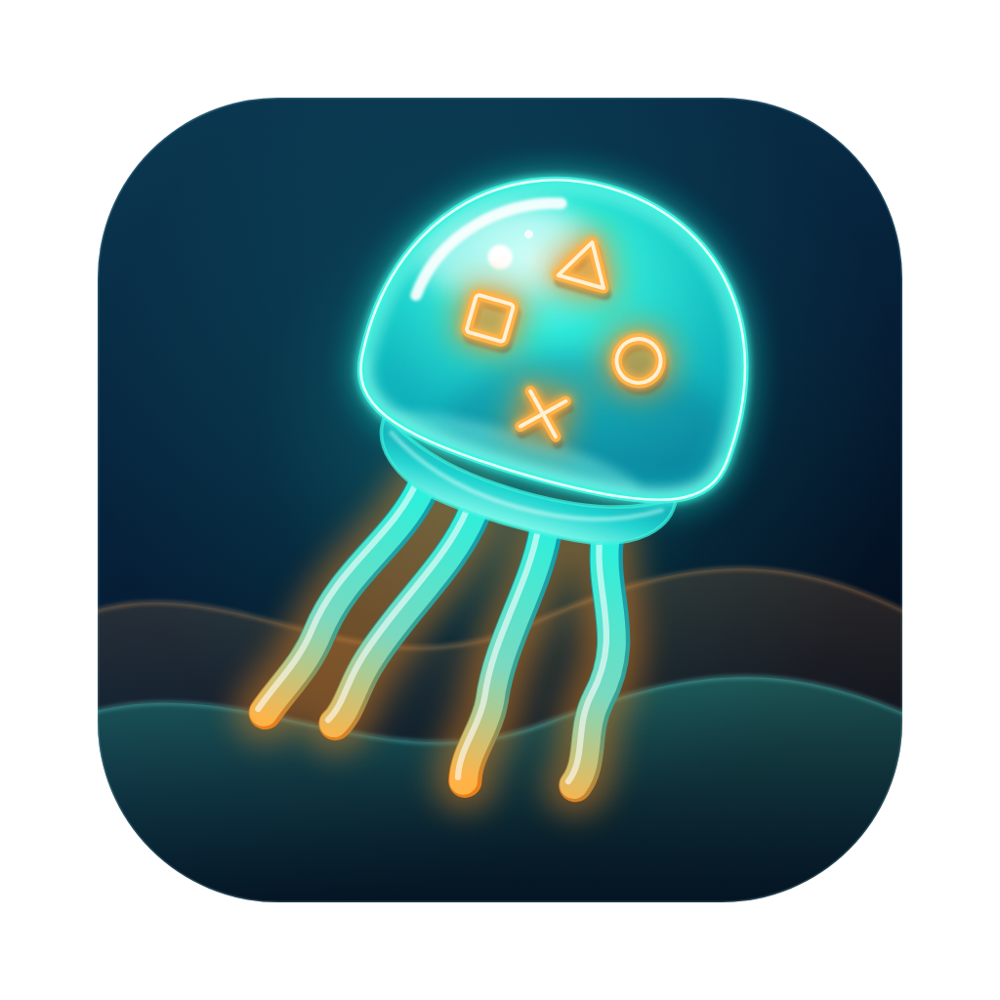

<p align="center"></p>

# JellyStation

Ein Media-Hub im Stil der PS3-XrossMediaBar (XMB) – Tauri 2 + React + TypeScript.

## Download

Die Installer der jeweils neuesten [Release](https://github.com/dconair/jellystation/releases/latest):

| System | Datei |
| ------ | ----- |
| macOS (Apple Silicon: M1 und neuer) | [JellyStation-Mac-AppleSilicon.dmg](https://github.com/dconair/jellystation/releases/latest/download/JellyStation-Mac-AppleSilicon.dmg) |
| macOS (Intel) | [JellyStation-Mac-Intel.dmg](https://github.com/dconair/jellystation/releases/latest/download/JellyStation-Mac-Intel.dmg) |
| Windows | [JellyStation-Windows-Setup.exe](https://github.com/dconair/jellystation/releases/latest/download/JellyStation-Windows-Setup.exe) |

Die Apps sind nicht signiert. Mac: beim ersten Öffnen Rechtsklick → „Öffnen“ (siehe [docs/ANLEITUNG-MAC.md](docs/ANLEITUNG-MAC.md)).
Windows: SmartScreen zeigt eine Warnung, dort „Weitere Informationen“ → „Trotzdem ausführen“.

```bash
npm install
npm run dev          # nur Frontend im Browser (Demo-Daten)
npm run tauri dev    # komplette Desktop-App
npm run tauri build
```

> **Mac: einmal einrichten, danach ein Befehl.** Ausführliche Anleitung mit Bildern: [docs/ANLEITUNG-MAC.md](docs/ANLEITUNG-MAC.md)
>
> ```bash
> # einmalig (Terminal):
> bash -c "$(curl -fsSL https://raw.githubusercontent.com/dconair/jellystation/main/scripts/bootstrap.sh)"
> # danach immer: aktualisieren + starten
> jellystation            # auch: --web, --build, --no-update, --status
> ```

## Ersteinrichtung & Einstellungen

Beim Start wird zuerst die gespeicherte Konfiguration geladen (`src/settings`, Tauri-Store →
`~/Library/Application Support/dev.jellystation.app/settings.json`, im Browser `localStorage`).
Fehlt sie, erscheint statt des Menüs der Setup-Assistent (`src/setup`): Jellyfin-Zugang testen →
Spiele-Ordner per nativem Dialog wählen → Controller prüfen → Abhängigkeiten prüfen. Nach „Einrichtung abschließen“
wird alles gespeichert und das Menü mit den echten Werten neu gestartet. Erneut aufrufbar über
*Einstellungen → Einrichtung erneut ausführen*.

## Bedienung

| Aktion                      | Tastatur             | Controller (DualShock 4) |
| --------------------------- | -------------------- | ------------------------ |
| Navigieren                  | Pfeiltasten, Mausrad | D-Pad / linker Stick     |
| Bestätigen                  | Enter                | ✕ (Button 0)             |
| Zurück (zum ersten Eintrag) | Esc / Backspace      | ○ (Button 1)             |
| Ton an/aus                  | M                    |                          |
| Vollbild                    | F11                  |                          |

Alle Eingabewege laufen durch denselben Handler (`dispatch` in `src/xmb/Xmb.tsx`) und lösen
dieselben Fokus-Animationen und Soundeffekte aus. Der Gamepad-Hook liegt in `src/input/useGamepad.ts`.

## Spielebibliothek

- Basisordner: wird im Setup gewählt (gespeichert in den Einstellungen); `GAMES_BASE_DIR` in `src/config/games.ts` ist nur der Standardwert.
- Ein einziger Ordner genügt: ISOs, CHD, CUE/BIN, Spieleordner und Programme (`.app`) kommen unsortiert hinein, auch in
  beliebige Unterordner. Der Rust-Befehl `games_scan` (`src-tauri/src/library.rs`) durchsucht ihn rekursiv und erkennt das System –
  am Inhalt (z. B. `PS3_GAME/PARAM.SFO`, `SYSTEM.CNF`, GameCube-/Wii-Disc-Kopf), sonst an Seriennummer im Dateinamen,
  Dateiformat (`.cso`, `.pkg`, `.rvz` …) oder einem Ordnernamen wie `PS3/`. Jedes System wird zur Kategorie „Spiele · <System>“ mit dem
  passenden Emulator; der Dateiname ohne Endung ist der Titel. Dateien werden **nie verschoben**.
- „Spiele · Nicht zugeordnet“ sammelt, was sich nicht sicher erkennen lässt. ✕ öffnet die Zuordnung (mit Vorschlag), △ ändert
  jederzeit das System eines Spiels, auch ausblenden geht. Die Zuordnungen stehen in den Einstellungen (`gameSystems`) und lassen
  sich unter Einstellungen → Spiele-Zuordnung zurücksetzen.
- Cover: gleichnamiges Bild neben dem Spiel (`Spiel.iso` + `Spiel.jpg`/`png`/`webp`) oder in `covers/`, `media/covers/`, `images/`;
  ohne Bild entsteht ein Platzhalter-Cover. Filme/Serien holen ihre Plakate aus Jellyfin.
- Existiert der Ordner nicht (oder läuft die App im Browser), erscheinen Demo-Daten
  (3 Konsolen × 5 fiktive Spiele, Hinweis „Vorschau-Modus“).
- Per Dialog gewählte Ordner werden zur Laufzeit für das Auslesen freigegeben und per `persisted-scope` gemerkt;
  die festen Pfade in `src-tauri/capabilities/library.json` gelten nur für den Standardordner und RPCS3.

## Funktionen (Auswahl)

Menü „Zuletzt“, Serien-Screen mit Staffel-Auswahl und Folgen-Details, Player mit Vorschaubildern und Pause-Bild, automatische Spiele-Cover,
Web-Bereich mit Lesezeichen und Download-Ablage, Einstellungen für Server, Ordner, Farben, Hintergrund-Designs, Animationen, Menü-Töne und
generative Hintergrundmusik. Übersicht für Nutzer: [docs/ANLEITUNG-MAC.md](docs/ANLEITUNG-MAC.md#6a-menüpunkte-im-überblick).

## Emulatoren (macOS)

- Katalog: `src/emulators/catalog.ts` (+ `emulators.json` für das Installationsskript). PS1 → DuckStation, PS2 → PCSX2, PS3 → RPCS3,
  PSP → PPSSPP, GameCube/Wii → Dolphin.
- `scripts/install-emulators.sh` (auch Teil von `setup-mac.sh`; `jellystation --emulators`) erkennt und installiert sie
  (Homebrew bzw. GitHub, SHA-256, ohne sudo) und legt `~/JellyStation/Games/<System>` und `~/JellyStation/BIOS` an.
- Gestartet wird über den Rust-Befehl `game_launch` (kein fester Shell-Scope); die XMB bleibt offen und zeigt „Läuft“.
  *Einstellungen → Emulatoren* zeigt Status, Installationshilfe und das Startprotokoll.

## Player (Jellyfin)

`src/player/`: Vollbild-Player im PS3-Stil (Direct Play, sonst HLS-Umwandlung durch den Server, Untertitel, Tonspuren,
Fortsetzen, Folgenliste, „Nächste Folge“). Die Verbindung läuft in der Desktop-App über einen lokalen Medien-Proxy
(`src-tauri/src/media_proxy.rs`). Details: `docs/ARCHITEKTUR.md`.
